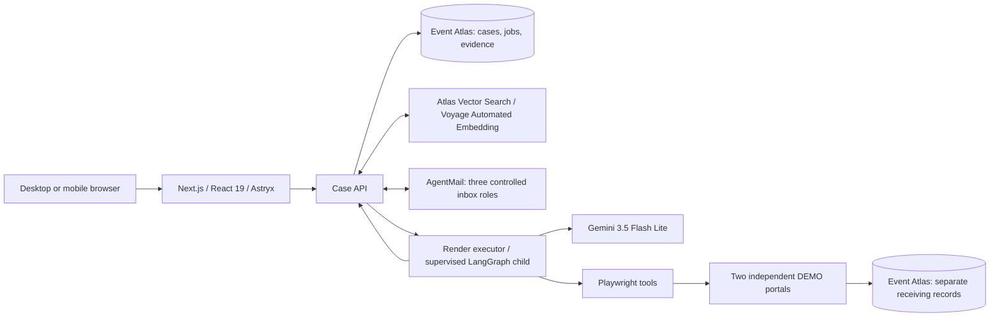

# Ontara

Report a local problem once. Approve the recipient and facts, then follow verified reporting progress through a worker crash, a changed form and requests for more information.

Ivan and Faaris built Ontara for **Agents in Context Toronto, Track 3: Finish the Job**, on November 14, 2026. The demonstration uses two labelled, team-controlled municipal portals and three controlled AgentMail inboxes. A verified receipt means the reporting action was acknowledged; it does not mean the physical problem was repaired.

## Demo status

| Deliverable | Verified state |
| --- | --- |
| Receiving portals | Public on [Render](https://ontara-portals-35iy.onrender.com); the [MongoDB health check](https://ontara-portals-35iy.onrender.com/healthz) passed |
| Case API | [Public API](https://ontara-api-35iy.onrender.com) persists approved versions, verified receipts and opted-in resident notifications; the recorded core flow proved draft hold/release and API restart persistence |
| Resident web | [Public web app](https://ontara-web-35iy.onrender.com) has compact category tiles, one report form, a searchable 444-municipality selector and inline Send report / Send update approval. Browser voice has been removed; earlier qualification records remain separately identified below |
| Executor | `fd572d12` is live on Render Free Linux with pinned Chromium `159.0.8154.6`; actual process crash and fresh-process receipt recovery passed |
| Hosted Roads proof | Complete: crash/recovery with one create and one ticket, held-mail restart, actual v2 form, withheld lesson, native/model mapping, new resident approval, same-ticket update and three received emails |
| Graffiti and resident controls | Separate hosted Graffiti intake/approval/receipt and unused-draft cancellation rejection passed; mobile, session isolation, cookie and origin checks passed |
| Local integrated rehearsal | Real Atlas, Playwright, native Voyage retrieval, Gemini and AgentMail passed the main Roads journey |
| Agent Engine | Integration code exists; free/event entitlement and hosted persistence/recovery remain unqualified |
| ElevenLabs | Backend/provider foundation and historical synthetic-microphone proof are retained. Browser voice is removed; call-in voice is the intended future channel, but no telephone number or integration is configured |
| Review package | Hosted demo available; exact one-minute audio/video and concise project text prepared for Ivan and Faaris to review. They approve the deliverables and submit manually; no agent upload or submission |

The hosted Roads run used web `056c192d`, API `6b273f04`, executor `fd572d12` and portal `e749693`. A real `SIGKILL` ended the first Linux child; a fresh child reconciled the same receipt with **one create request and one ticket**. An actual API restart preserved the verified receipt and authority outbox at zero send attempts. After the same run's update form changed to v2, a withheld-lesson inspection made zero model calls and zero writes. A real email from the simulated authority then drove native Voyage retrieval, a Gemini mapping and the authored landmark question. Ordinary UI save/review/new approval produced a v2 acknowledgement on the same ticket, followed by received authority-response and resident-notification emails.

The [hosted execution proof](services/executor/evidence/cloud-final-hosted-proof-20261114.json) and [hosted UI proof](apps/web/scripts/cloud-qa/evidence/hosted-ui-20261114.json) retain sanitized counts and matching checks for the core run. The earlier [local integrated rehearsal](services/executor/evidence/local-integrated-proof-20261114.json) remains separately labelled. The later `ae1e0e46` catalogue build passed hosted read-only navigation, preview and responsive checks without creating another report.

## The resident journey

The interface uses buttons, authored questions and ordinary inputs. The homepage groups the nine categories in a compact desktop 3×3 grid, with a simple explanation of reporting, approval and follow-up below. On phones it uses two columns with full category labels. All nine categories have ordinary navigation buttons and nested routes. Roads, Sidewalks & Traffic and Graffiti support configured synthetic demo routes. The other seven lead to empty, disabled form previews with disabled submission. All 39 inactive leaves and their location/details/review deep links collect no data, create no drafts and make no backend requests. The server also rejects inactive-service writes.

The Regional Roads Portal (DEMO) receives the synthetic Halton pothole. The Local Municipality Portal (DEMO) receives synthetic public-wall graffiti in Milton. Location and asset responsibility determine the recipient. Research about a municipality never enables live submission to it.

Valid drafts save in the background while the resident fills one compact report form. The inline review shows the exact saved facts, source-backed route and named demo recipient. One **Send report** approves that version. Material edits invalidate readiness until the current version is saved. Later requests use one focused missing-detail panel and **Send update** approval. Case IDs alone grant no access; the API uses a browser-session cookie for ownership.

A separate optional email field opts the approved case into generic filing, information-needed, update and assistance notifications. This address is not added to the portal contact payload and is locked after the first approved operation. Filing/update messages require verified receipts; other notifications require genuine case events. Provider acceptance is **SENT**, while **RECEIVED** requires evidence from a configured controlled receiving inbox. The email link requires the original owner browser; it is not a magic sign-in link. Historical cases are not backfilled, and no resolved/repair notification or arbitrary email-reply parser is claimed.

Ordinary Roads reporting stops at its verified filing receipt. The advanced changed-form story is enabled only by the private operator's preapproval follow-up hold. Residents do not switch on a demo mode.

The website uses written forms. Browser microphone controls and the ElevenLabs browser SDK have been removed at the team's request. The backend/provider foundation and previously stored private transcripts remain available for future call-in work; no telephone number or integration is configured.

The earlier [hosted browser check](apps/web/scripts/cloud-qa/evidence/hosted-voice-20261114.json) used one synthetic microphone session: provider speech was decoded, the spoken answer populated the canonical field, and Stop ended every test microphone track and the provider socket. Manual completion saved one unapproved draft. The [independent observer](scripts/voice/evidence/hosted-voice-observer-20261114.json) verified the actual provider transcript, private owner/case linkage, fresh-session denial and zero approval, operation or job. A separate real-provider text test completed the full authored-question sequence. These are historical qualification records for the removed browser flow, not current browser or telephone availability. [Voice foundation and historical proof](scripts/voice/README.md).

## How the work survives interruption

One bounded LangGraph workflow performs the execution. It uses Playwright for receiving forms and **Gemini 3.5 Flash Lite** (`gemini-3.5-flash-lite`) for structured changed-form mapping. The model selects approved fact IDs; application validation supplies the exact values.



The verified hosted runtime is the documented **Render Free fallback**. Its HTTP supervisor survives the graph child's deliberate process death and starts a fresh child. That child uses one direct Atlas checkpoint saver. The separate, unqualified Agent Engine path uses only `app.checkpointer()`; both savers are never configured on the same path. See the [agent](services/agent/README.md) and [executor](services/executor/README.md) documentation.

The case API's Atlas ledger remains authoritative. It freezes each approved version, operation ID and payload digest, then records `dispatch_started` before the browser write. An unresolved operation performs exact receiving-system lookup before any retry. The demo receiver deduplicates stable references and exposes receipts; these are explicit receiver capabilities, not a guarantee about arbitrary municipal websites.

For the form change, the worker inspects current fields and retrieves an applicable verified lesson. The v2 follow-up splits location into road/intersection, direction and position, and adds a required nearest landmark. Missing knowledge pauses the bounded policy before a model call or update. Missing facts produce an authored resident question. The final write requires renewed approval and a matching acknowledgement for the original ticket.

The applicable lesson is labelled `seeded_demo`: a developer supplied its initial calibration mapping, verified the actual browser update and promoted it with a real receipt reference. Subsequent local and hosted runs used native retrieval and model-derived mappings. [Lesson provenance and exclusions](scripts/retrieval/evidence/seeded-rehearsal-lesson-20261114.json).

## MongoDB and the Roads directory

The event Atlas Sandbox holds exact private case state, approved versions, durable jobs, correspondence, execution events, receipts and actual private voice transcripts. GridFS retains obtained documents, form snapshots and other evidence. Public published procedures and verified execution lessons have separate collections; private case, mail and voice histories are excluded from shared vector memory.

Atlas Automated Embedding with **`voyage-4-large`** is the required retrieval path. Both `service_procedures_autoembed_v1` and `procedural_lessons_autoembed_v1` index curated `retrievalText` with `autoEmbed`. The app supplies text and scoped `$vectorSearch.query.text` queries. Atlas generates document and query embeddings and refreshes them after text changes. The observed native configuration is 1024 dimensions, scalar quantization and cosine similarity. Optional reranking is disabled.

Authority, issue, visibility, verification and exact current record versions constrain retrieval. Lessons also require matching portal, workflow and form scope. A generally queryable index does not establish that a new record version is searchable; bounded text/version probes record that evidence separately. [Native setup and verification](scripts/retrieval/README.md), [text/update proof](scripts/retrieval/evidence/native-preflight-20261114.json).

The location selector includes **all 444 official Ontario municipalities**: 241 lower tier, 173 single tier and 30 upper tier. Milton is explicitly paired with Halton Region, and all 207 existing IDs remain stable. The [canonical directory and source validation](data/municipal/MUNICIPALITY_OPTIONS.md) are selection metadata only; listing a municipality does not enable reporting there.

The separate procedural research directory covers **20 upper-tier municipalities** selected by their actual member municipalities' 2021 Census populations. Halton was imported first. Four batches produced 22 verified, native-searchable procedure or handoff records; one partial record stays excluded. These are published facts and handoffs, all labelled `research_only`.

The 20-by-8 matrix has **160 cells: 3 detailed published procedures, 112 general or responsibility handoffs, and 45 explicit gaps**. The handoff count includes 111 verified cells and one partial cell. General contact details do not establish asset ownership, accepted intake fields or a live integration. See the [coverage matrix](data/municipal/coverage_matrix.md), [research and source limitations](data/municipal/README.md), and [independent native search summary](scripts/retrieval/evidence/twenty-area-search-summary-20261114.json).

The supplementary boundary import contains 207 municipality geometries. They support candidate geography; confirmed incident location and asset responsibility still require validation. Boundary enrichment changed no indexed procedure text or versions.

## Run and verify

Use Node `>=22.13.0 <25` and the pinned Python dependencies in each service. Local development was exercised with Python 3.13; the executor container uses Python 3.12 and its matching Chromium. Follow each component's setup instructions before using these repository-root entry points:

| Component | Development entry point | Setup |
| --- | --- | --- |
| Web | `npm --prefix apps/web run dev` | [Web README](apps/web/README.md) |
| Case API | `python services/api/scripts/run_local.py` | [API README](services/api/README.md) |
| Receiving portals | `PYTHONPATH=services/portals python -m ontara_portals` | [Portal README](services/portals/README.md) |
| Executor and fallback child | `PYTHONPATH=services/agent/src:services/executor/src python -m ontara_executor` | [Executor README](services/executor/README.md) |
| Native index readiness | `python scripts/retrieval/native_probe.py` | [Retrieval README](scripts/retrieval/README.md) |

The coordinated local ports are web 3000, API 8001, portals 8002 and executor 8003. Set the web's server-only `ONTARA_API_URL` to the API origin. Configure the API's executor origin only when the selected worker is ready to consume approved jobs. Production services use HTTPS, secure cookies and private server environment settings.

Credentials belong outside the repository. Local starters parse the team's private environment files as data; hosted services receive secrets through environment settings. Keep Atlas/model/mail keys, internal and presenter tokens, session cookies, and ticket capability URLs out of public logs, browser bundles and recordings. The receiver's presenter token is separate from the application's internal token.

Public evidence uses aliases, matching booleans and counts. Earlier Git history contains lookup metadata for two retired synthetic test fixtures; their mutable ticket-access capabilities have been revoked. Immutable acceptance receipts, provenance and counters remain historical evidence. [Sanitized maintenance proof](services/portals/evidence/retired-fixture-maintenance-20261114.json).

Useful checks after dependency setup:

```sh
PYTHONPATH=services/api python -m pytest services/api/tests -q
PYTHONPATH=services/agent/src:services/executor/src python -m pytest services/agent/tests services/executor/tests -q
PYTHONPATH=services/portals python -m pytest services/portals/tests -q
npm --prefix apps/web run typecheck
npm --prefix apps/web run test:ui
npm --prefix apps/web run build
```

Unit and browser-contract tests do not establish hosted integration. Native retrieval, actual receiving receipts, real mail delivery and cloud process recovery have separate evidence gates. The backend owns the [shared contracts](contracts/openapi.json); generated catalogue and question files are reused by the interface and execution workflow.

## Three-minute presentation runbook

The earlier hosted run passed the advanced sequence below. The current presentation is Roads-only. Warm the services, check native procedure/lesson readiness, open the resident and redacted presenter views, and prepare fresh synthetic inputs. Keep administrative controls and private URLs off the projected screen. Ordinary reports stop at filing; only the privately staged advanced case continues through the synthetic authority question.

1. On an unused supported Roads draft, before resident approval, use internal Bearer authentication for `POST /internal/v1/cases/{id}/fault-next-create` with `{"kind":"kill_after_acceptance","armed":true}` and `POST /internal/v1/cases/{id}/follow-up-hold` with `{"held":true}`. `GET` on the hold path must show `held:true` and `nextCreateFaultArmed:true`. Approval atomically arms the one-shot create fault before dispatch. When the initial receipt queues the authority question, it stays durably `HELD`, with zero send attempts and inspection delayed.
2. After the fresh worker verifies the recovered initial v1 receipt, change that same run's actual Roads update form from v1 to v2 through the receiving portal's [presenter control](services/portals/README.md#presenter-controls). Run the separate, read-only withheld-lesson diagnostic while mail remains held: it must pause with zero model calls and zero writes.
3. Release the question with `POST /internal/v1/cases/{id}/follow-up-hold` and `{"held":false}`. The API verifies the saved initial receipt and reads the configured same-run v2 schema and snapshot digest before the mail module releases the existing outbox entry. Repeated releases reuse that entry.

| Time | Show |
| --- | --- |
| 0:00-0:40 | Nine categories, a Roads issue, confirmed incident location, authored answers, source-backed recipient review and approval |
| 0:40-1:15 | The prearmed create runs after approval. The portal accepts; the real worker process dies; a fresh process looks up the same operation and records its receipt |
| 1:15-1:35 | Redacted receiving counters: one create request, one ticket; show the different process/attempt IDs. Change the same run's update form to v2, show the read-only withheld-lesson pause, then release the mail hold |
| 1:35-2:35 | A genuine simulated-authority email schedules the positive read-only inspection. Show the changed DOM and native lesson/model evidence. Answer the authored landmark question, approve, and verify an update to the same ticket |
| 2:35-3:00 | Same-ticket acknowledgement, observed notification status, native Atlas/Voyage evidence and scope limits |

For an explicitly staged case, the verified initial receipt queues the controlled authority question; the draft hold keeps it unsent until the recovered receipt and actual form change are ready. The [mail runbook](scripts/mail/README.md) explains polling, duplicate handling and the authenticated [existing-case helper](scripts/mail/trigger_followup.py). Receiving email never authorizes a portal write. The loop uses Ontara, simulated-authority and test-resident inbox roles; the accelerated wait and simulated authority are disclosed. The [hosted mail summary](scripts/mail/evidence/cloud-mail-summary.json) records the earlier three-message/six-copy proof, restart persistence and stable counts after duplicate delivery. New opt-in filing/information notifications have their own purpose-specific counts and require fresh hosted qualification; historical totals do not prove the new path.

Use the [recorded hosted proof](services/executor/evidence/cloud-final-hosted-proof-20261114.json) to review the sequence and start a fresh synthetic run for presentation. The Mac displays the demo; execution runs on Render's Linux service.

Warm every service before starting the presentation clock. The [observed Free Render idle-recovery run](services/executor/evidence/cloud-free-idle-recovery-20261114.json) recorded 270.8 seconds from approval to worker lease after idle, then 8.5 seconds from that lease to receiving acceptance. An HTTP health response alone does not establish that the entire service chain is warm.

Run the read-only [cloud warm-up helper](services/executor/scripts/warm_cloud.py) with the team's private cloud configuration. It checks all four verified origins, including authenticated Chromium readiness, without creating a case, job, message or model request.

## Event work and attribution

The event-built work includes the authored catalogue and question bank, Astryx resident journey, case/version/approval ledger, durable scheduling, controlled receiving portals, real process-crash reconciliation, changed-form validation, native text retrieval and automatic-update evidence, curated municipal source imports, GridFS evidence storage, and the controlled mail loop.

The implementation uses existing React/Next.js, Astryx, FastAPI, PyMongo, LangGraph, Playwright and provider libraries. MongoDB Atlas and Voyage supply database and retrieval services; Gemini supplies structured generation; AgentMail supplies real email transport. These libraries and services are dependencies, not original team code. The interface's [Figtree licence](apps/web/public/licenses/figtree.txt) is retained with its font assets.

Prepare an accessible demo, a one-minute video with functioning audio and video, and a concise project description for Ivan and Faaris to review. They approve the deliverables and submit manually through Cerebral Valley. Their package includes the public repository, demo, video, description, both team members and Track 3 selection. Submission access and a submission receipt are not prerequisites for preparing this review package. The event deadline is November 14 at 5:00 PM Toronto time.
